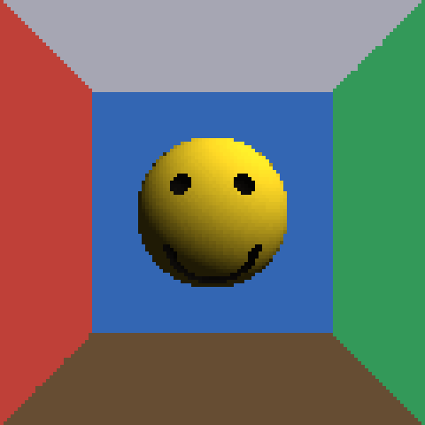
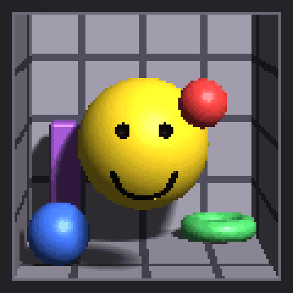

# ray-march

Two small CPU ray marching experiments written in [Odin](https://odin-lang.org/).
Every pixel is computed on the CPU into a 120x120 buffer; [raylib](https://www.raylib.com/) only opens the window and shows it.

<table>
  <tr>
    <td align="center"><a href="#smiley"></a></td>
    <td align="center"><a href="#parallax"></a></td>
  </tr>
  <tr>
    <td align="center"><b>Smiley</b><br>orbit camera</td>
    <td align="center"><b>Parallax</b><br>head-coupled window</td>
  </tr>
</table>

Both need only Odin, which ships raylib in its `vendor` collection.
Each prints frame-time statistics to stdout once per second.

## Smiley

`main.odin` draws a yellow smiley face inside a box with six colored walls, built from signed distance functions.

```sh
odin build . -o:speed
./ray-march-test
```

| Input | Action |
| --- | --- |
| Left drag | Orbit the camera around the face |

## Parallax

`parallax/` holds the same kind of scene, but the screen is treated as a window into a shadow box.
Moving your head shifts the view through the window, so the box walls and the ball floating in front of the glass move with real parallax.

```sh
odin build parallax -o:speed
./parallax.bin
```

| Input | Action |
| --- | --- |
| Mouse | Move your head relative to the card |
| Space | Toggle an automatic sway |
| C | Re-center head tracking |

### Head tracking

Optional. A webcam tracker finds your eyes with MediaPipe and sends their position to the renderer over UDP, so your real head drives the view instead of the mouse.

```sh
cd parallax
python3 -m venv .venv && .venv/bin/pip install -r requirements.txt
.venv/bin/python tracker.py
```

Run it alongside the renderer. When the tracker stops, the mouse takes over again.
